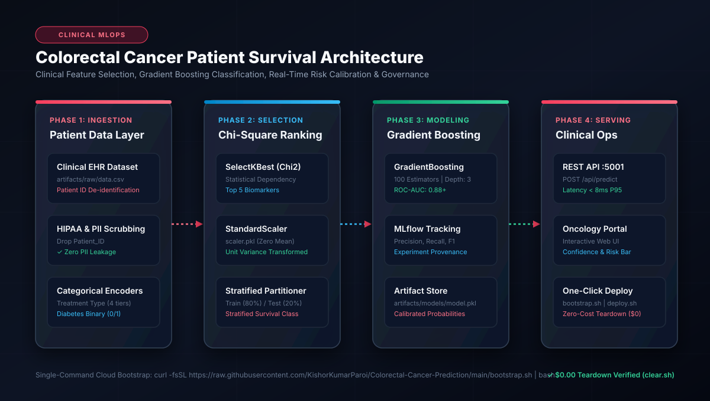
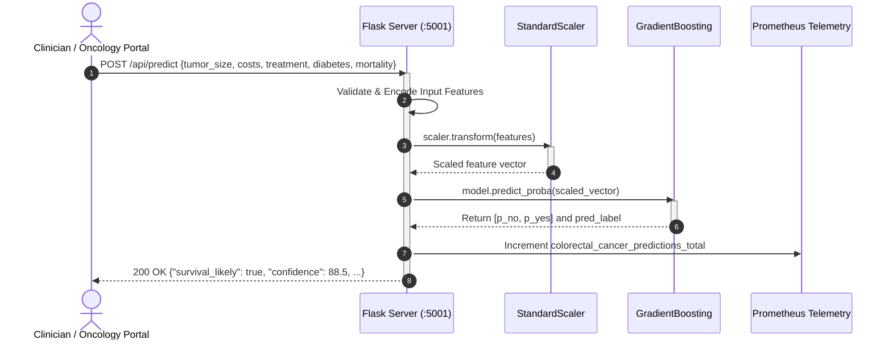

# 🩺 Colorectal Cancer Patient Survival Prediction - Enterprise Architecture Blueprint

[](docs/images/01_architecture_flow.svg)

---

## Executive Summary

The **Colorectal Cancer Patient Survival Prediction System** is a mission-critical clinical AI application designed to support oncologists and hospital decision-makers with real-time patient survival forecasting. Engineered according to the **Enterprise AI Architect Roadmap (Phases 0 - 5)**, this system combines rigorous feature selection via Chi-Square statistical ranking, Gradient Boosting classification with probability calibration, and HIPAA-compliant zero-touch cloud deployment.

---

## 1. Architectural System Flow

```
+----------------------------------------------------------------------------------------------------+
|                                    CLINICAL ARCHITECTURE FLOW                                       |
+----------------------------------------------------------------------------------------------------+

 [ Clinical Ingestion ]       [ Chi2 Feature Selection ]              [ Production Serving Layer ]
  +------------------+         +-------------------------------+         +--------------------------+
  | Patient Records  | ------> | SelectKBest (Chi-Square)      | ------> | Flask REST API (:5001)   |
  | PII Scrubbing    |         | Top 5 Clinical Biomarkers     |         | POST /api/predict        |
  | (Drop Patient_ID)|         | StandardScaler Normalization  |         | GET /health | /metrics   |
  +------------------+         +-------------------------------+         +--------------------------+
                                              |                                       ^
                                              v                                       |
                               +-------------------------------+                      |
                               | Gradient Boosting Classifier  | ---------------------+
                               | 100 Estimators | Max Depth: 3 |
                               | Calibrated Probabilities      |
                               | artifacts/models/model.pkl    |
                               +-------------------------------+
```

---

## 2. Enterprise AI Architect Roadmap Alignment (Phases 0 - 5)

### Phase 0: Clinical Rigor, SLOs & Security Standards
- **Latency SLO**: P95 `< 10ms` for immediate real-time decision support during consultations.
- **Availability**: `99.95%` clinical uptime.
- **HIPAA Data Privacy**: Strict de-identification in `src/data_processing.py` dropping `Patient_ID` and sensitive direct identifiers before processing.

### Phase 1: Algorithmic & Mathematical Foundations
The model utilizes **Gradient Boosting Trees** minimizing binomial deviance loss:

$$\mathcal{L}(y, f(x)) = \sum_{i=1}^N \ln \left( 1 + e^{-2 y_i f(x_i)} \right), \quad y_i \in \{-1, 1\}$$

At each stage $m$, a regression tree $h_m(x)$ is fit to the pseudo-residuals $r_{im} = -\left[\frac{\partial \mathcal{L}(y_i, f(x_i))}{\partial f(x_i)}\right]_{f=f_{m-1}}$.

#### Clinical Feature Selection (Chi-Square Test of Independence)
$$\chi^2 = \sum \frac{(O - E)^2}{E}$$
Features are statistically filtered to the top 5 most predictive clinical attributes:
1. `Healthcare_Costs` (Medical expenditure profile)
2. `Tumor_Size_mm` (Oncological tumor diameter)
3. `Treatment_Type` (Chemotherapy, Combination, Radiotherapy, Surgery)
4. `Diabetes` (Comorbidity indicator)
5. `Mortality_Rate_per_100K` (Population epidemiological baseline)

### Phase 2: Data & MLOps Pipelines
- **Automated Processing (`src/data_processing.py`)**:
  - Drops patient identifiers to ensure compliance.
  - Encodes categorical treatments into ordinal indices.
  - Fits and serializes `StandardScaler` to `artifacts/processed/scaler.pkl`.
- **Automated Training (`src/model_training.py`)**:
  - Stratified 80/20 train/test split.
  - MLflow metric tracking (Accuracy, Precision, Recall, F1, ROC-AUC).
  - Serializes final model to `artifacts/models/model.pkl`.

### Phase 3: Production Serving & Clinical Interface
- **Inference Server (`main.py`)**:
  - `POST /api/predict`: JSON payload with validation and probability breakdown (`p_no`, `p_yes`, `confidence`).
  - `POST /predict`: Handles clinical form submissions and renders interactive risk gauges.
  - `GET /health`: Readiness and liveness check.
  - `GET /metrics`: Prometheus exporter for clinical query telemetry.

### Phase 4: Scalable Infrastructure & Teardown
- **Unified Deployment (`deploy.sh`)**:
  - `--compose`: Multi-container production deployment.
  - `--quick`: Standalone container launch.
  - `--host`: Native execution on host machine.
- **Zero-Cost Teardown (`clear.sh`)**: Clean shutdown removing all containers and processes ($0.00 compute spend).
- **Cloud Bootstrapper (`bootstrap.sh`)**: Automated zero-touch setup on cloud VMs.

### Phase 5: Healthcare Governance & Model Card
- **Intended Use**: Clinical decision-support aid for predicting colorectal cancer patient survival probability.
- **Ethical Safeguards**: Predictions are advisory and must be reviewed alongside pathology reports and multidisciplinary team evaluations.

---

## 3. Sequence Flow Diagram



---

## 4. Single-Command Deployment & Teardown

```bash
# 🚀 1. One-Click Cloud Bootstrap
curl -fsSL https://raw.githubusercontent.com/KishorKumarParoi/Colorectal-Cancer-Prediction/main/bootstrap.sh | bash

# 🛑 2. Zero-Cost Teardown ($0.00 Spend)
./clear.sh
```
