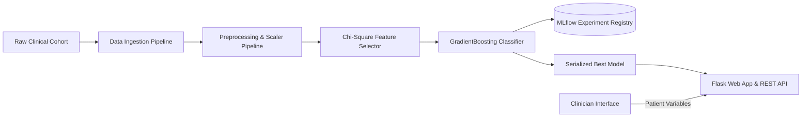

# Colorectal Cancer Prognosis & Survival Prediction Platform

An end-to-end, production-grade MLOps system for clinical colorectal cancer survival prognosis and recurrence risk estimation, built with **Python**, **Scikit-Learn**, **MLflow**, and **Flask**.

---

## 🔬 Project Overview

Colorectal cancer is one of the most common and critical malignancies worldwide. Accurate prognostic modeling enables clinicians to tailor adjuvant chemotherapy regimens and surveillance intervals. This project provides a complete machine learning lifecycle solution:

- **Data Preprocessing & Encoding**: Robust imputation, clinical variable normalization, and feature transformations.
- **Statistical Feature Selection**: $\chi^2$ (Chi-squared) statistical testing to isolate statistically significant prognostic biomarkers and clinical predictors.
- **Model Training & Experiment Tracking**: GradientBoosting and ensemble classifiers tracked with **MLflow** for hyperparameter tuning and model lineage.
- **Clinical Prognosis Serving**: High-performance Flask REST API and responsive glassmorphic web UI for clinician interactive assessment.

---

## 🏛️ System Architecture



---

## 📁 Repository Structure

```
.
├── config/                  # Pipeline schema and hyperparameter configurations
├── src/
│   ├── components/          # Ingestion, preprocessing, and model trainer modules
│   ├── pipeline/            # Training and inference pipeline orchestration
│   ├── entity/              # Pydantic data schemas and configurations
│   ├── exception.py         # Custom clinical pipeline exception handler
│   └── logger.py            # Structured system logging
├── templates/               # Glassmorphic clinical web application templates
├── static/                  # Responsive styling and CSS assets
├── artifacts/               # Processed datasets, scalers, and model checkpoints
├── main.py                  # Pipeline execution and Flask web application entrypoint
├── pyproject.toml           # Unified packaging and environment definitions
└── requirements.txt         # Production dependencies
```

---

## 🚀 Quickstart

### 1. Installation
```bash
git clone https://github.com/KishorKumarParoi/Colorectal-Cancer-Prediction.git
cd Colorectal-Cancer-Prediction
pip install -r requirements.txt
```

### 2. Run the Web Application
```bash
python main.py
```
Navigate to `http://127.0.0.1:5000` to access the prognosis risk evaluation interface.

---

## 👤 Author
**Kishor Kumar Paroi**  
GitHub: [@KishorKumarParoi](https://github.com/KishorKumarParoi)
